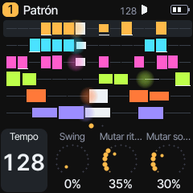
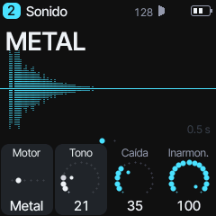
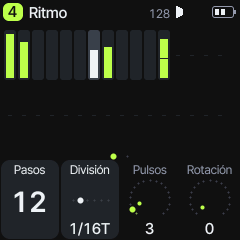

# auto-chre

Caja de ritmos generativa para el **M-VAVE FM-1**: percusión sintética, ritmos que se rompen y mutan solos, a lo IDM.

  

> **Estado: 0.2, sin probar todavía en una FM-1 real.** El motor, el secuenciador y las pantallas se prueban en el ordenador (`tests/run_tests.sh`). Instálalo bajo tu responsabilidad.

## Qué hace

- **6 pistas de síntesis**, sin muestras. Cada pista puede usar cualquiera de estos 10 motores:
  - **Bombo**: seno con caída de tono, clic y saturación.
  - **Metal**: seis osciladores cuadrados inarmónicos, como los platos del 808, con anillo, brillo y ruido.
  - **Ruido**: ruido blanco o granulado (sample & hold) con filtro LP / BP / HP y barrido.
  - **Clic**: blips cortos (seno, cuadrada o impulsos) que caen de tono, en ráfagas repetidas.
  - **Glitch**: trocea lo que la máquina acaba de tocar (el último segundo y medio), con tono, al revés y en bucle.
  - **FM**: dos operadores con índice que cae, realimentación y ratios inarmónicos.
  - **Cuerda**: cuerda pulsada (Karplus-Strong): brillo, excitación (ruido o pulso), posición y saturación.
  - **Modal**: objeto golpeado con cuatro resonadores: barra, cristal, campana o membrana, con golpe duro o blando.
  - **Ácido**: sierra o cuadrada por un paso-bajo resonante con envolvente, estilo 303.
  - **Chip**: onda de pulso con arpegio rápido sobre la escala, deslizamiento y vibrato.
- **Notas en escala** (EDIT, página 3): cada pista puede tocar notas de una escala. *Notas*: Fija, Azar, Sube, Baja, Péndulo o Turing (un bucle de 8 notas que va mutando). *Rango*: 1 a 3 octavas. *Esc. pista*: la escala global (Afinar) o una propia de la pista. En los motores tonales (Cuerda, Modal, Ácido, Chip) el *Tono/Octava* elige la octava de la raíz; en los demás, las notas mueven la afinación del sonido.
- **Cada golpe es distinto.** La *Variación* mueve los ajustes del motor, la afinación y el nivel en cada golpe. *Bits* y *Decimar* destrozan cada pista por separado.
- **Polimetría.** Cada pista tiene su longitud (1–32 pasos) y su división (1/32 a 1/4, también tresillos), así que van desfasándose: 7 contra 9 contra 16.
- **Por paso:** velocidad, *ratchets* (1–4 golpes) y retraso. **Por pista:** probabilidad, ratchets al azar, microtiempo al azar y una **máquina de Turing** que cambia pasos cada vez que la pista da la vuelta.
- **Euclidiano:** *Pulsos* y *Rotación* rehacen el patrón repartiendo los golpes.
- **Mutadores:**
  - **ARP = MUTAR RITMO**: cambia pasos, ratchets, retrasos y velocidades. Si la mutación es fuerte, también cambia longitudes y divisiones.
  - **LFO = MUTAR SONIDO**: mueve los ajustes de los motores. Si es fuerte, también puede cambiar el motor.
  - La cantidad de cada mutación se regula en la pantalla PATRÓN. Las pistas **bloqueadas** no cambian, y la tecla 20 **deshace** la última mutación.
- **Efectos:** filtro peine (*comb*) y delay ping-pong sincronizado en el envío *Delay*; **reverb** de placa con su propio envío por pista (*Reverb*), cola y oscurecer; saturación, volumen y **stutter** en la salida. El stutter repite 1/4 a 1/64, con las teclas o automático.
- **Afinar:** raíz, escala global y la escala de la pista. Con *Cuantizar* activado, la afinación y la variación de tono de todas las pistas caen en la escala; con *Notas* distinto de Fija, la pista siempre toca dentro de su escala.
- **Reloj interno o MIDI.** Por MIDI, las notas 36–41 tocan las pistas (el canal se elige en Sistema).

## Controles

| Control | Qué hace |
|---|---|
| **HOME** | PATRÓN: las 6 pistas corriendo, el tempo, el swing y la cantidad de cada mutación. Si lo pulsas otra vez: silencio, bloqueo, probabilidad y variación de la pista. |
| **EDIT** | SONIDO: el motor de la pista y sus 6 ajustes, con el sonido dibujado; página 3: notas en escala. |
| **ENV** | VOZ: nivel, panorama, envío al delay, envío a la reverb, bits, decimar y afinación. |
| **SEQ** | RITMO: pasos, división, pulsos y rotación (euclidiano). Página 2: probabilidad, ratchet, microtiempo y Turing. |
| **FX** | EFECTOS: comb, delay y salida, reverb, stutter. |
| **SCL** | AFINAR: raíz, escala global, cuantizar y escala de la pista. |
| **GLO** | SISTEMA: batería, CPU, canal MIDI, reloj y el mapa de teclas. |
| **SAVE** | PRESETS. Dentro de PRESETS, SAVE guarda (dos veces si la ranura ya está ocupada) y K2 a la derecha carga. |
| **PLAY / REC** | Arrancar o parar / grabar lo que tocas con las teclas en el patrón. |
| **ARP / LFO** | Mutar ritmo / mutar sonido. |
| **K1–K4** | Los cuatro diales de la pantalla. |
| **SELECT** | Página. |
| **ALGORITHM, OCT− / OCT+** | Cambiar de pista (OCT− y OCT+ juntos 5 s: modo actualización). |
| **PRESETS** | Ranura. |

**Las teclas** (de izquierda a derecha):

| Teclas | Qué hacen |
|---|---|
| 1–6 | Tocar las pistas. Con REC, se graban en el patrón. |
| 7–12 | Silenciar las pistas. |
| 13–17 | Stutter mientras las mantienes (1/4, 1/8, 1/16, 1/32, 1/64). |
| 18 | CAOS: microtiempo al máximo mientras la mantienes. |
| 19 | LLENAR: ratchets en todas las pistas mientras la mantienes. |
| 20 | Deshacer la última mutación. |
| 21–26 | Bloquear las pistas para que no muten. |
| 27 | *Tap tempo*. |

## Instalar

**Instalador web:** **https://thephonus.github.io/auto-chre/**. Ábrelo en Chrome o Edge, conecta la FM-1 por USB y pulsa **Instalar**.

Desde el firmware oficial, Mini-Grain o amb-iguos puedes instalar directamente. Si tienes otro firmware no oficial, vuelve antes al oficial **V15**, también desde el instalador. Hay una copia de la V15 en [FM1 Unbricker](https://quixotic7.github.io/MvaveFM1Unbricker/).

**Con Python:** `python3 tools/fm1_install.py auto-chre.fwsc`. El archivo está en Actions → la ejecución más reciente → artefacto **auto-chre-fwsc**.

La identidad del paquete es `FM-1_947`.

## Compilar y probar

Mira [BUILDING.md](BUILDING.md). Para las pruebas en el ordenador, `sh tests/run_tests.sh`: genera 70 s de la máquina tocando sola en `build/demo.wav` y todas las pantallas en `build/ui/`.

## Licencia

GPL-3.0-only. Usa la plataforma de amb-iguos, Mini-Grain y Felucca / Mini-Tone (Leo Kuroshita, Hügelton Instruments). Mira [LICENSING.md](LICENSING.md).
